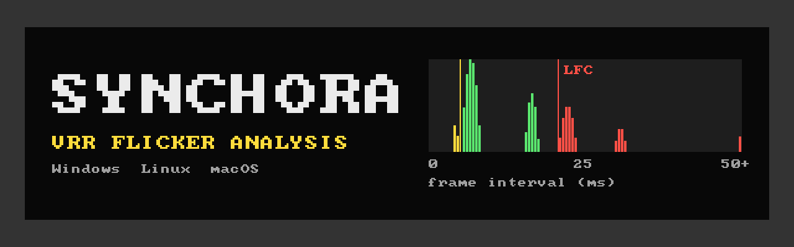

<p align="center">
  
</p>

<h1 align="center">Bzzrt: VRR flicker test and LFC diagnostic</h1>

<p align="center">
  <b>Find the source of variable refresh rate flicker: frame pacing, low framerate compensation (LFC) or the panel itself.</b><br>
  FreeSync · G-SYNC Compatible · VESA Adaptive-Sync · HDMI VRR · ProMotion
</p>

<p align="center">
  <a href="https://github.com/Prajwaljb/Bzzrt/releases/latest"></a>
  <a href="https://github.com/Prajwaljb/Bzzrt/actions/workflows/build.yml"></a>
  
  
  <a href="LICENSE"></a>
  <a href="https://github.com/Prajwaljb/Bzzrt/releases"></a>
</p>

<p align="center">
  <a href="#download">Download</a> ·
  <a href="packaging/QUICKSTART.txt">Quickstart</a> ·
  <a href="docs/VRR_LFC_GUIDE.md">VRR &amp; LFC guide</a> ·
  <a href="#2-running">Usage</a> ·
  <a href="#1-building">Building</a>
</p>

---

## Download

| Platform | Package | Needs |
|---|---|---|
| 🪟 **Windows** 10/11 x64 | [`bzzrt-…-windows-x64.zip`](https://github.com/Prajwaljb/Bzzrt/releases/latest) | D3D12 or D3D11 GPU |
| 🐧 **Linux** x86_64 | [`bzzrt-…-linux-x86_64.tar.gz`](https://github.com/Prajwaljb/Bzzrt/releases/latest) | Vulkan driver, glibc 2.34+ (Ubuntu 22.04+, Fedora 35+, Arch) |
| 🍎 **macOS** 12+ Apple silicon | [`bzzrt-…-macos-arm64.zip`](https://github.com/Prajwaljb/Bzzrt/releases/latest) | not notarized: allow it once under System Settings → Privacy & Security → *Open Anyway* |

Unpack it, start it on the monitor you want to test and press **ENTER**. Bzzrt reads the monitor's VRR range from
its EDID. If it can't find one, or the detected range is wrong, you type in the range before the test starts
(see [QUICKSTART](packaging/QUICKSTART.txt)). Checksums are in `SHA256SUMS` on the release page.

**Arch Linux and derivatives** (CachyOS, EndeavourOS, Manjaro): install the ready-made package from the
[latest release](https://github.com/Prajwaljb/Bzzrt/releases/latest). This adds `vrrdiag` (also as `bzzrt`) and a
"Bzzrt" app-menu entry.

```
sudo pacman -U https://github.com/Prajwaljb/Bzzrt/releases/download/v1.1.1/bzzrt-1.1.1-1-x86_64.pkg.tar.zst
```

Or build it yourself from [`packaging/aur/PKGBUILD`](packaging/aur/PKGBUILD):

```
git clone https://github.com/Prajwaljb/Bzzrt.git
cd Bzzrt/packaging/aur && makepkg -si
```

## What it does

`vrrdiag` generates **controlled presentation timing** (exact frame intervals, scripted
rate switches, frame-time spikes and jitter) so you can find out whether VRR flicker comes from:

* low framerate compensation (LFC, frame multiplication below the VRR floor),
* individual frame-time spikes,
* transitions between normal VRR and LFC, or
* something unrelated to VRR (cable, link, panel, overdrive, FRC).

It is a native application on every platform:

| Platform | Backend | Presentation path |
|---|---|---|
| Windows 10/11 | **Direct3D 12** (default), Direct3D 11 fallback | DXGI flip model (`FLIP_DISCARD`), `ALLOW_TEARING`, frame-latency waitable |
| Linux | **Vulkan WSI** on Wayland or X11 | FIFO / FIFO_RELAXED / MAILBOX / IMMEDIATE, `VK_KHR_present_id` + `VK_KHR_present_wait`, `VK_GOOGLE_display_timing` |
| Linux (advanced) | **Direct DRM/KMS** from a text console | atomic page flips with `VRR_ENABLED` controlled by the app, kernel flip timestamps |
| macOS 12+ (Apple silicon) | **Metal** on a `CAMetalLayer` | native fullscreen, `displaySyncEnabled`, `MTLDrawable.presentedTime` |

> **Software cannot prove that the monitor is in VRR or LFC.** The app knows exactly when it
> *submitted* each frame and, where the driver exposes it, when the OS/driver says the frame was
> *presented*. It cannot see what the panel actually scanned out. Watch the monitor's OSD refresh
> readout, or film the screen with a high-speed camera, to confirm what the panel is doing.
> See [docs/VRR_LFC_GUIDE.md](docs/VRR_LFC_GUIDE.md).

## Common questions

**Why does my FreeSync or G-SYNC Compatible monitor flicker at low FPS?**
Below the monitor's VRR minimum (often 48 Hz) the panel cannot hold a frame any longer, so the driver must show frames
twice or more (low framerate compensation, LFC), or the panel forces a repeat on its own. Many panels, VA panels in
particular, change brightness with how long each frame is held. Entering and leaving LFC therefore shows up as
flicker. Bzzrt runs steady and switching tests on both sides of the minimum so you can see where it starts.

**Is VRR flicker a defect of my monitor?**
It depends on when it happens. Flicker at a *steady* frame rate inside the VRR range, while the computer delivers
evenly timed frames, points to the monitor. Flicker only when the frame rate crosses the minimum, or only when the frame
timing is uneven, is a known VRR side effect or a driver / compositor problem. Bzzrt measures the timing and tells you
which case you have.

**How do I find my monitor's VRR range?**
Bzzrt reads it from the monitor's EDID (FreeSync data block, DisplayID Adaptive-Sync, HDMI VRR or range limits) and
shows it on the start screen. If it is missing or wrong, press **R** and type the range from the spec sheet.

**Does it work on Linux and Wayland?**
Yes. It uses Vulkan on Wayland (KDE, GNOME, Hyprland, Sway) and X11, plus an optional direct DRM/KMS mode that bypasses
the compositor. Windows uses Direct3D 12 and macOS uses Metal.

---

## 1. Building

Requirements: CMake ≥ 3.16 and a C++17 compiler. There are no third-party libraries beyond the OS and graphics SDKs.

### Windows (Visual Studio 2022, Windows 10/11 SDK)

From a "Developer PowerShell for VS 2022" (or any shell with CMake):

```powershell
cmake -S . -B build -G "Visual Studio 17 2022" -A x64
cmake --build build --config Release
.\build\Release\vrrdiag.exe --help
```

Ninja works as well (`cmake -S . -B build -G Ninja -DCMAKE_BUILD_TYPE=Release` from a VS developer prompt).
The executable links the CRT statically and needs only `d3d12.dll`, `dxgi.dll` and `d3dcompiler_47.dll`, which ship with Windows.
`-DVRRDIAG_D3D11=OFF` drops the D3D11 fallback.

### Linux

Install the development packages:

```bash
# Arch / CachyOS / Manjaro
sudo pacman -S --needed base-devel cmake ninja pkgconf vulkan-headers vulkan-icd-loader glslang \
                        wayland wayland-protocols libxcb libdrm
# plus your Vulkan driver: vulkan-intel | vulkan-radeon | nvidia-utils

# Debian / Ubuntu
sudo apt install build-essential cmake ninja-build pkg-config libvulkan-dev glslang-tools \
                 libwayland-dev wayland-protocols libxcb1-dev libxcb-randr0-dev libdrm-dev mesa-vulkan-drivers

# Fedora
sudo dnf install gcc-c++ cmake ninja-build pkgconf vulkan-loader-devel vulkan-headers glslang \
                 wayland-devel wayland-protocols-devel libxcb-devel libdrm-devel
```

Build:

```bash
cmake -S . -B build -G Ninja -DCMAKE_BUILD_TYPE=Release
cmake --build build
./build/vrrdiag --help
```

Wayland, X11 and DRM/KMS support are each enabled automatically when their development files are found
(`-DVRRDIAG_WAYLAND=OFF`, `-DVRRDIAG_X11=OFF` and `-DVRRDIAG_KMS=OFF` disable them). If `glslangValidator` is missing, the
pre-compiled SPIR-V in `shaders/prebuilt/` is used.

### macOS (Xcode command line tools)

```bash
./package-macos.sh                 # dist/macos/Bzzrt.app (arm64, macOS 12+)
ARCHS="arm64;x86_64" ./package-macos.sh   # universal build for Intel Macs too
```

The Metal shader is compiled at runtime; `build-mac/metal_shader_check` compiles it ahead of time to catch errors.

### Packaged app

| Platform | Command | Result |
|---|---|---|
| Linux | `./package-linux.sh` | `dist/linux/` with `vrrdiag`, `vrrdiag-launch` (writes logs to `~/vrrdiag-logs`), docs and icon |
| Linux | `./package-linux.sh --install` | also installs `~/.local/bin/vrrdiag{,-launch}` and a "Bzzrt" app-menu entry (right-click it for "Advanced test bench" and "Start windowed") |
| Windows | double-click `build-windows.bat` (needs VS 2022 with the C++ workload, and CMake) | `dist\windows\vrrdiag.exe`, a single self-contained file. When double-clicked it writes CSV logs next to itself. |
| macOS | `./package-macos.sh` | `dist/macos/Bzzrt.app`, ad-hoc signed. Logs go to `~/Documents/Bzzrt` when started from Finder. |
| All three | push to GitHub | `.github/workflows/build.yml` builds and uploads all three packages |
| Windows from Linux | `cmake -S . -B build-win -G Ninja -DCMAKE_BUILD_TYPE=Release -DCMAKE_TOOLCHAIN_FILE=cmake/mingw-w64-x86_64.cmake && cmake --build build-win` | `build-win/vrrdiag.exe` (needs `mingw-w64-gcc` or llvm-mingw on `PATH`) |

To uninstall the Linux menu entry, delete `~/.local/bin/vrrdiag`, `~/.local/bin/vrrdiag-launch`,
`~/.local/share/applications/vrrdiag.desktop` and `~/.local/share/icons/hicolor/scalable/apps/vrrdiag.svg`.

---

## 2. Running

### Guided flicker check (default)

Start `vrrdiag` (or "Bzzrt" from the app menu, double-click `vrrdiag.exe` on Windows, or open
`Bzzrt.app` on macOS) and press **ENTER**, or start it with `vrrdiag --check` to begin right away. Eight 10-second
tests (seven in the Windows low-refresh test below) run one after another on a dark gray screen. During each one press **Y** if you see flicker, **N** if you
don't, **S** if unsure. The test advances on its own.

The tests are built from **your monitor's VRR range** (see below). For a 48-200 Hz monitor they are:

| # | Test | Why |
|---|---|---|
| 1-3 | 90 / 60 / 50 FPS steady | inside the VRR range: must look perfectly stable; 50 is just above the minimum |
| 4 | random 55-80 FPS | rate changes inside the range |
| 5-6 | 45 / 30 FPS steady | below the 48 Hz minimum: needs frame doubling (LFC) |
| 7 | 60 <-> 45 FPS every second | crossing the minimum, the classic flicker trigger |
| 8 | random 45-55 FPS | jitter around the minimum |

A 40-144 Hz monitor gets 90 / 60 / 42 / 46-65 / 38 / 25 FPS and so on: always in range, just above the minimum, 6 %
and 37 % below it, and frame rates crossing it.

### The monitor's VRR range

The start screen shows two ranges side by side, and you choose which one the check uses:

* **Detected**: read from the monitor's EDID (the FreeSync data block, the DisplayID Adaptive-Sync block, the HDMI VRR
  range, or the display range limits; Linux: sysfs / X11 RandR / KMS, Windows: the monitor's registry key) or the
  range macOS reports for the display.
* **Your entry**: press **R** and type the minimum, ENTER, the maximum, ENTER (and optionally the LFC threshold).
  The range is in the monitor's spec sheet ("FreeSync range 48-144 Hz"); if only the maximum is listed, 48 Hz is the
  most common minimum.

**A** switches between them. Entering a range selects it; the detected one is never thrown away. Both, and your
choice, are remembered per monitor in `~/.config/bzzrt/ranges.txt`, `%APPDATA%\Bzzrt\ranges.txt` or
`~/Library/Application Support/Bzzrt/ranges.txt`. If nothing is detected and you have not entered a range, the check
**asks before it starts**. `--vrr-min HZ --vrr-max HZ` on the command line override both.

Why keep both: detection is not always right. The EDID range limits are not necessarily the VRR range, monitors with
"FreeSync Standard / Extended" modes often report the same EDID for both, HDMI and DisplayPort can have different
ranges, adapters and docks can rewrite the EDID, and laptop panels usually report nothing. The start screen also says whether **LFC is possible**:
frame doubling needs the maximum to be at least twice the minimum (48-144 Hz yes, 48-75 Hz no). With a narrow range,
flicker below the minimum is a limit of the monitor and the conclusion says so. If the display mode runs below the
monitor's maximum (e.g. a 144 Hz monitor set to 60 Hz), the check uses the reduced range and tells you to raise it.

`--lfc-threshold FPS` (or the third field of the range editor) sets the frame rate below which frames are expected to
be shown several times; the default is 1.1 x the minimum.

For every test the app also measures, from the driver's presentation timestamps, whether frames reached the screen
at the requested times (**EVEN**), irregularly (**UNEVEN**), or snapped to the fixed refresh rate (**FIXED
REFRESH**, VRR off). The result screen combines this with your answers:

- flicker where the computer's timing was **even** at a steady rate -> points to the **monitor**;
- flicker only where the timing was **uneven** -> caused on the **computer side** (driver / compositor);
- run the same check on Windows and Linux and compare.

If your monitor's menu (OSD) can show the current refresh rate, type the number during each steady test. With VRR the
panel refreshes at the frame rate **or a whole multiple of it**: many drivers show each frame several times to keep the
refresh rate high, so 90 FPS can read 180 Hz and 45 FPS can read 90 or 180 Hz. That is VRR working, not a fault. A
reading stuck at the fixed refresh rate (e.g. 200 Hz at 90 FPS) means VRR is off. The app explains each reading.

**Low-refresh test (Windows).** Windows drivers often repeat frames (e.g. 45 FPS shown at 135-180 Hz), which keeps
the panel far from its minimum, so a normal Windows run cannot reproduce flicker that happens near the minimum.
Press **L** on the start screen to run the check in an exclusive-fullscreen display mode below twice the minimum
(60 Hz for a 48 Hz minimum, chosen from the modes the display offers): the VRR ceiling drops to that rate, frames below
the minimum cannot be repeated, and the monitor runs at its minimum like it does with drivers that lack LFC (e.g.
Linux on Intel). If it flickers there too, the flicker is the monitor's behaviour at very low refresh rates; if not,
the flicker seen elsewhere comes from that system's driver.

**Frame doubling experiment (all platforms).** `--double-frames` makes the app itself show every frame slower than the
LFC threshold two or more times at even intervals (45 FPS as 90 even refreshes), the way a driver with LFC would.
Each repeat is a real present, and the report says how many landed on time. If the steps below the minimum stop
flickering, the missing frame doubling of the driver is the cause, not the monitor: `vrrdiag --double-frames --check`.

The result is also saved as `vrrdiag-report-<date>.txt` next to the per-test CSV logs. **R** / **A** enter or switch the VRR range,
**H** hides the text, **LEFT/RIGHT** change the pattern, **F** toggles fullscreen, **ESC** stops a running check (and quits
on the start screen), **TAB** opens the advanced test bench, **Q** quits.

### Advanced test bench

```bash
vrrdiag --advanced                        # borderless fullscreen, idles at 100 FPS, SPACE starts a test
vrrdiag --test switch47-50 --start        # start a test right away (after a 0.75 s warm-up)
vrrdiag --test stable47 --start --duration 30 --exit-after
vrrdiag --fps 52 --start                  # custom stable rate
vrrdiag --test spikes60 --spike-rate 1 --spike-min 30 --spike-max 30 --spike-frames 2 --seed 7 --start
vrrdiag --pattern 1 --no-overlay          # dark gray with no overlay: best for seeing VRR flicker
vrrdiag --list-tests
```

Linux specific: `--wsi wayland|x11`, `--api kms`, `--gpu N` (hybrid laptops: pick the GPU that drives the monitor).
Windows specific: `--api d3d11`, `--exclusive`, `--gpu N`. macOS: `--gpu N` (Metal device index).
Everywhere: `--vrr-min`, `--vrr-max`, `--lfc-threshold`, `--double-frames`, `--version`.

### Keys

| Key | Action |
|---|---|
| `SPACE` | start / stop the selected test (stats reset at start; CSV saved at stop) |
| `UP` / `DOWN`, `PGUP` / `PGDN` | select test |
| `+` / `-` (`Shift` = ×10) | custom target FPS (switches to the "custom" test) |
| `LEFT` / `RIGHT`, `G` | pattern |
| `F11` or `F` | cycle windowed → borderless fullscreen (→ exclusive fullscreen on Windows) |
| `V` | toggle VSync ↔ tearing / unsynchronized present mode |
| `P` | cycle through all present modes |
| `C` | toggle 8-bit ↔ 10-bit swap chain |
| `H` | hide/show the overlay |
| `K` | binary frame counter (for high-speed camera analysis) |
| `L` | CSV logging on/off (applies to the next test start) |
| `[` / `]` | test duration (∞, 10, 30, 60, 120, 300, 600 s) |
| `R` / `Shift+R` | random seed +1 / −1 |
| `TAB` | back to the guided check |
| `Q`, `ESC` | quit |

### Tests

| id | Description |
|---|---|
| `stable200` … `stable30` | 200, 144, 120, 100, 90, 60, 55, 50, 48, 47, 45, 40, 30 FPS |
| `custom` | stable FPS set with `+`/`-` or `--fps` |
| `lfc50`, `lfc47` | stable 50 FPS (just above a 48 Hz floor) / 47 FPS (just below); use `--fps` for other floors |
| `sweep` | smooth 45 → 55 → 45 FPS triangle sweep (`--sweep-period`) |
| `switch47-50` | 50 ↔ 47 FPS every `--switch-period` seconds |
| `switch60-45`, `switch100-45`, `switch200-45` | X → 45 → X FPS |
| `spikes60` | 60 FPS with random 25–50 ms frames (`--spike-rate/-min/-max/-frames`) |
| `drops55` | 55 FPS with random drops to 40–45 FPS (`--drop-rate/-duration/-min/-max`) |
| `jitter45-55` | every frame random between 45 and 55 FPS |
| `lows` | constant average (`--lows-avg`) where `--lows-percent` % of frames run at `--lows-fps` |

All random tests use a deterministic SplitMix64 generator. **The same seed produces the same frame-time
sequence on Windows, Linux and macOS**, so systems can be compared frame for frame.

### Patterns

0 mid gray (50 %), 1 dark gray (20 %), 2 white, 3 black, 4 bright gradient, 5 static high-contrast checkerboard,
6 moving bars (960 px/s, driven by the scheduled present time), 7 user image (`--image file.bmp|.ppm`;
convert other formats with `magick in.png out.bmp`).

VRR brightness flicker on VA panels is most visible on **dark and mid gray**. Hide the overlay (`H`) for the cleanest view.

### What the overlay shows

API, GPU, output name/monitor, nominal mode and refresh rate, window mode, swap-chain/image format, present mode,
tearing support, whether driver presentation timing is available, the test, target FPS, measured FPS (last 1 s),
current/average frame time, 1 % and 0.1 % lows, the largest spike, frames slower than the VRR floor and the number of
floor crossings, `Present`/`vkQueuePresentKHR` call duration and status, driver-reported present intervals, and a
present-interval histogram with the VRR maximum and minimum (the floor) marked, and the VRR range in use.

Definitions: *1 % low* = 1000 / (99th-percentile frame time); *0.1 % low* = 1000 / (99.9th-percentile frame time).
*Frame time* = interval between consecutive present calls. *Floor crossing* = a frame on the other side of
1000 / VRR minimum ms than the frame before it.

---

## 3. Platform notes and required settings

### Windows

* Enable Adaptive-Sync/FreeSync in the **monitor OSD** and use DisplayPort (or USB-C DP Alt Mode).
* Driver: AMD Software → Display → *AMD FreeSync*: On. NVIDIA Control Panel → *Set up G-SYNC* → enable for the
  monitor, "Enable for full screen mode" (or windowed and full screen). Intel Graphics Command Center / Arc Control →
  Display → *Adaptive Sync*: On.
* Windows 11: Settings → System → Display → Graphics → *Variable refresh rate* / *Optimizations for windowed games*
  (helps windowed/borderless flip-model presentation).
* Use **borderless fullscreen** (default) or `--exclusive`. VRR requires DWM *independent flip*. Confirm it with
  [PresentMon](https://github.com/GameTechDev/PresentMon) (`PresentMon --process_name vrrdiag.exe`): the PresentMode
  column must read `Hardware: Independent Flip` or `Hardware Composed: Independent Flip`. `Composed: Flip` means DWM is
  compositing and VRR is **not** in effect.
* Present modes: `tearing` (default when supported) = `Present(0, DXGI_PRESENT_ALLOW_TEARING)`, which Microsoft
  documents as required for VRR outside exclusive fullscreen; the app paces frames itself, so nothing tears inside
  the VRR range. `vsync` = `Present(1, 0)`; `nosync` = `Present(0, 0)`.
* The app opens on the screen under the mouse (double-click it on the external monitor) and renders on the GPU that
  monitor is connected to. On hybrid laptops, rendering on the other GPU forces a cross-adapter copy that usually
  prevents VRR. `--gpu N` overrides this, and the start screen warns when the two GPUs differ.
* If VRR still stays off, press **F** on the start screen until it says *Exclusive fullscreen*. Things the app cannot
  override: VRR switched off in the GPU driver or by IT policy, DisplayLink USB docks (no VRR at all), and always-on-top
  overlays (for example screen watermarks or notification tools) that force DWM composition.
* The overlay shows DXGI's `BitsPerColor` and the link bit depth reported by `QueryDisplayConfig`.
  Windows chooses 8 bpc versus 10 bpc (and FRC/dithering) for the link independently of the swap-chain format.

### Linux: Wayland

The compositor decides whether VRR is used. There is no Wayland protocol that reports VRR state to clients.

| Compositor | Setting |
|---|---|
| KDE Plasma (KWin) | System Settings → Display & Monitor → *Adaptive sync*: **Automatic** (fullscreen apps only) or **Always** |
| GNOME 50+ | Settings → Displays → *Variable Refresh Rate* |
| GNOME 46-49 | `gsettings set org.gnome.mutter experimental-features "['variable-refresh-rate']"`, then Settings → Displays → *Variable Refresh Rate* |
| Hyprland | `misc { vrr = 2 }` (fullscreen only) or `vrr = 1` (always) |
| Sway | `output <name> adaptive_sync on` |

Run fullscreen (the default). Don't move the mouse during a test: cursor updates can force extra refreshes on some
compositors. The app hides the cursor and tags its surface `content-type: game`.
With FIFO under a VRR compositor, frames are shown as soon as they are submitted (up to the maximum refresh).
IMMEDIATE only tears if the compositor supports `wp_tearing_control` and allows it.

### Linux: X11

* AMD (`xf86-video-amdgpu`): `Option "VariableRefresh" "true"` in a `Device` section of `/etc/X11/xorg.conf.d/20-amdgpu.conf`.
* Intel/modesetting: recent Xorg modesetting drivers accept the same option; check your Xorg log.
* NVIDIA: `nvidia-settings` → X Server Display Configuration / OpenGL Settings → *Allow G-SYNC on monitor not
  validated as G-SYNC Compatible* and *Enable G-SYNC/G-SYNC Compatible*.
* The compositor must unredirect fullscreen windows. The app sets `_NET_WM_BYPASS_COMPOSITOR=1` and `_VARIABLE_REFRESH=1`.
  Under XWayland the Wayland compositor's rules apply instead.

### Linux: drivers

* AMD (amdgpu): VRR and LFC (called "BTR" in the driver) are implemented in the kernel display code.
* Intel (i915/xe): VRR on Gen 12+ over DP/eDP. See the guide for how to tell from the timing data whether frames below
  the floor are multiplied.
* NVIDIA: needs `nvidia-drm.modeset=1`. Wayland VRR requires a recent driver and compositor.
* Hybrid laptops: render on the GPU that drives the monitor (`--gpu N`, see the list printed at startup). PRIME
  render offload adds a copy and may disable VRR.

### Linux: direct DRM/KMS backend (advanced, optional)

This backend removes the compositor completely. It sets the CRTC `VRR_ENABLED` property itself, flips CPU-drawn dumb
buffers with atomic commits, and logs the kernel's page-flip timestamps.

```bash
# switch to a free text console: Ctrl+Alt+F3, log in, then
cd ~/Code/VRR && ./build/vrrdiag --api kms --test switch47-50 --start
# Q quits and restores the console (Ctrl+Alt+F1/F2 returns to the desktop)
```

* It can't run while a compositor is DRM master on the same GPU. It tells you so if you try.
* Present modes: `vrr` (VRR_ENABLED=1), `fixed` (VRR_ENABLED=0, a non-VRR control run), `async` (tearing; kernel 6.8+).
  Changing VRR_ENABLED may cause a brief modeset blank.
* By default it picks the external connector that reports `vrr_capable=1`, at the preferred resolution and highest
  refresh rate (`--kms-connector DP-2 --kms-mode 2560x1440@200` to override). It shows the EDID monitor name and range
  limits, `vrr_capable` and `max bpc`.
* Drawing is done by the CPU. At 200 FPS, hide the overlay (`H`) to avoid late frames.
* Flip timestamps show when *our* flips were latched. They do not show any extra (LFC) scanouts the hardware inserts.
* `--double-frames` here gives the cleanest result, since every repeat is a page flip with no compositor in between:
  `vrrdiag-launch --api kms --double-frames --check`

### macOS

* Apple silicon Macs with macOS 14+ support Adaptive-Sync monitors: System Settings → Displays → the monitor →
  *Refresh Rate* = **Variable (48-144 Hz)** (the range shown is the monitor's). MacBook Pro ProMotion panels are
  variable by default. The check reads the range macOS reports; with a fixed refresh rate it asks for the range and
  warns that macOS is not using VRR.
* macOS only uses variable refresh for **fullscreen** apps: the check starts in native fullscreen (`F` toggles it).
* Timing comes from `MTLDrawable.presentedTime`, in the same clock as the app's own timestamps.
* The app is ad-hoc signed but not notarized. On first start, right-click `Bzzrt.app` → *Open* (macOS 15: System
  Settings → Privacy & Security → *Open Anyway*), or run `xattr -dr com.apple.quarantine Bzzrt.app`.
* From a terminal: `Bzzrt.app/Contents/MacOS/vrrdiag --help`.

---

## 4. CSV logs

Logging is on by default. The file `vrrlog_<date>-<time>_<test>.csv` is written to `--log-dir` (default: current directory).
Lines starting with `#` hold metadata: start time, API, GPU, output, mode, format, seed, notes, and the summary at the
end. Use `pandas.read_csv(f, comment='#')`.

| Column | Meaning |
|---|---|
| `frame` | frame number (monotonic, also the Vulkan present id) |
| `time_s`, `host_monotonic_ns` | when Present / flip was called (s since test start; raw monotonic ns) |
| `target_frametime_ms` | scheduled interval for this frame |
| `actual_frametime_ms` | measured interval since the previous Present call |
| `present_call_ms` | time spent inside Present / vkQueuePresentKHR / atomic commit |
| `present_status` | `S_OK`, `DXGI_STATUS_OCCLUDED`, `VK_SUCCESS`, `VK_SUBOPTIMAL_KHR`, `OK`, `EBUSY`, … |
| `late` | 1 if Present was called > 0.2 ms after the scheduled time |
| `below_vrr_floor` | 1 if the frame time exceeded 1000 / VRR minimum ms (LFC territory) |
| `target_fps` | 1000 / target frame time |
| `test_mode`, `window_mode`, `sync_mode`, `present_mode`, `color_format`, `display_mode` | state at that frame |
| `display_time_s` | OS/driver-reported presentation time (empty if unavailable) |
| `display_interval_ms` | difference to the previous frame's reported presentation time |
| `timing_source` | where `display_time_s` came from |

Timing sources: DXGI `GetFrameStatistics().SyncQPCTime` (Windows, mainly in independent flip / exclusive);
`VK_GOOGLE_display_timing` `actualPresentTime`; `VK_KHR_present_wait` completion (polled, ±0.2 ms; on Wayland it is
driven by the compositor's presentation feedback); KMS page-flip events; `MTLDrawable.presentedTime` (macOS). None of
these observe the panel itself.

---

## 5. How to use this to answer "is my monitor faulty?"

See **[docs/VRR_LFC_GUIDE.md](docs/VRR_LFC_GUIDE.md)**. It covers the test procedure, why average FPS is not enough,
why a single spike below the VRR minimum can trigger LFC, why stable 47 FPS can behave differently from 47↔50 switching, how to
read the driver timing, and what can and cannot be proven without the OSD or a high-speed camera.

## Source layout

```
src/common/   app loop, pacing, scheduler/tests, guided check, VRR range (EDID parser, saved ranges), stats,
              overlay, CSV, patterns (CPU), config
src/win/      Win32 window, DXGI base, D3D12 backend, D3D11 backend
src/linux/    Vulkan backend, Wayland and X11 windows, DRM/KMS backend, TTY input, sysfs EDID
src/mac/      Cocoa window, Metal backend
shaders/      pattern.hlsl (D3D), pattern.vert/.frag (Vulkan) + prebuilt SPIR-V, pattern.metal (Metal)
packaging/    Linux desktop entry, launcher and icon; macOS Info.plist; QUICKSTART
tools/        metal_shader_check (CI), make_banner.py (README banner and social preview), make_icon.py (app icon)
cmake/        MinGW-w64 toolchain file for cross-compiling the Windows .exe
```

## License

[MIT](LICENSE) © 2026 Prajwal JB
